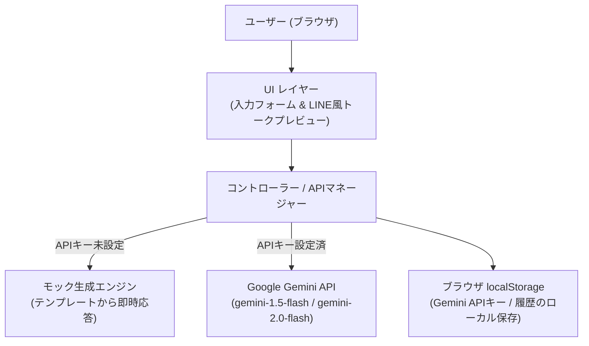

# LINEメッセージ下書き・返信AI（MessageCraft）仕様書【Google Gemini API 特化版】

## 1. プロジェクト概要

### 1.1 目的
「なんて返信すればいいかわからない」「角を立てずに断りたい」「気になる人を自然に誘いたい」といった日常のコミュニケーションの悩みを、**Google Gemini API**を活用してトーン別3パターンで即座に下書き・提案するWebアプリケーション。

### 1.2 コアバリュー & 差別化
- **LINEトーク画面風プレビュー**: 実際のスマホ画面で吹き出しとして表示されるため、送ったときの視覚的ニュアンス（文字量・改行・絵文字のバランス）が直感的にわかる。
- **ワンタップコピー**: 気に入った文面をボタン1つで即座にコピー可能。
- **トーン別3パターン提案**: 「自然・王道」「親しみ・フランク」「スマート・短文」などを同時に生成し、文面ごとに解説ポイントを添えて提示。
- **Gemini API & モック両対応**: 
  - APIキー未設定時は内蔵モック（ダミーデータ）で即座に体験可能。
  - Gemini APIキーを入力すると、`gemini-1.5-flash` / `gemini-2.0-flash` によるリアルタイム生成へシームレスに切り替え。

---

## 2. システム構成 & 技術スタック



- **フロントエンド**: HTML5, CSS3 (Tailwind CSS風モダンデザイン), JavaScript (Vanilla または React)
- **AIエンジン**: **Google Gemini API**
  - 推奨モデル: `gemini-3.8-flash` / `gemini-3-flash`（任意のモデル名を直接入力可能なカスタム入力対応）
  - レスポンス形式: `application/json` (Structured Outputs / JSON Mode)
- **セキュリティ・データ保存**:
  - APIキーは外部サーバーを介さず、ユーザーのブラウザ（`localStorage`）内のみで安全に保持。
  - Google Gemini APIエンドポイント（`https://generativelanguage.googleapis.com/v1beta/...`）へ直接HTTPS通信。

---

## 3. 機能要件

### 3.1 入力項目 (Input)
| 項目名 | 形式 | 必須 | 説明 / 選択肢 |
| :--- | :--- | :---: | :--- |
| **相手との関係** | ドロップダウン | ○ | 「気になる人・好きな人」「友達」「上司・先輩」「同僚・後輩」「取引先・目上の人」「家族」 |
| **伝えたいこと / 要件** | テキストエリア | ○ | 例: 「今週末ご飯に誘いたい」「体調不良でバイトを休みたい」「来週の予定をリスケしたい」 |
| **相手のメッセージ** | テキストエリア | 任意 | 返信の場合に入力。相手の発言文脈に沿った返しを生成 |
| **トーン / ニュアンス** | チップ選択 / プルダウン | ○ | 「自然・おすすめ」「親しみ・フランク」「丁寧・誠実」「短め・スマート」 |
| **絵文字・顔文字** | ラジオ / プルダウン | ○ | 「普通（自然に入れる）」「控えめ・なし」「多め・明るく」 |

### 3.2 出力項目 (Output)
Gemini APIからJSON形式で以下の**3パターン**を取得し、LINE風プレビューに描画する。

1. **パターンA: 自然・王道（一番おすすめ）**
   - 相手との関係性に最も適したバランスの良い文面。
2. **パターンB: 親しみ・フランク（距離を縮める / 重くしない）**
   - 軽快で返信プレッシャーを与えない文面。
3. **パターンC: 丁寧・気遣い（誠実 / 角を立てない）**
   - 相手への配慮や感謝・お詫びがしっかり伝わる文面。

各パターンのUI操作:
- **［コピー］ボタン**: クリップボードへコピー（「コピー完了！」のトースト通知表示）
- **文字数表示**: 目安の文字数を表示
- **AIの意図・ワンポイント解説**: なぜこの言い回しにしたかの理由を表示

---

## 4. 画面レイアウト設計

画面は「PC表示（2ペイン左右分割）」と「スマホ表示（縦スクロール）」に対応。

```
+-----------------------------------+-----------------------------------+
|  [⚙️ Gemini設定] LINEサポAI        |  📱 LINE風プレビュー (スマホ画面枠) |
+-----------------------------------+-----------------------------------+
| 【条件入力】                       | +-------------------------------+ |
| 1. 相手との関係                   | | < 戻る    トーク相手      🔍 ≡| |
|    [ 気になる人・恋人候補 ▼ ]     | +-------------------------------+ |
|                                   | |                               | |
| 2. 相手から来たメッセージ(任意)    | | [相手]                        | |
|    [ 最近バタバタしてて返信遅れた!]| |  (入力したメッセージを表示)  | |
|                                   | |                               | |
| 3. あなたが伝えたいこと           | |                        [自分] | |
|    [ 落ち着いたらご飯行こうと誘う ]| |        (選択中の生成メッセージ)| |
|                                   | |                               | |
| 4. トーン & 絵文字                | +-------------------------------+ |
|    [ 自然 ▼ ] [ 絵文字: 普通 ▼ ]   |                                   |
|                                   | 【生成結果タブ (3パターン)】        |
| [ 🚀 メッセージを生成する ]        | [ パターンA ] [ パターンB ] [ C ]  |
|                                   |  本文プレビュー...                |
| [⚙️ Google Gemini APIキー設定]     |  [ 📋 本文をコピー ]              |
+-----------------------------------+-----------------------------------+
```

---

## 5. Google Gemini API 設計

### 5.1 API呼び出し仕様
- **エンドポイント**:
  `https://generativelanguage.googleapis.com/v1beta/models/gemini-1.5-flash:generateContent?key=${API_KEY}`
- **HTTPメソッド**: `POST`
- **リクエスト設定**:
  - `generationConfig.responseMimeType`: `"application/json"`
  - `generationConfig.temperature`: `0.7`

### 5.2 システムインストラクション (プロンプト)
```text
あなたはLINE・チャットコミュニケーションのプロフェッショナルです。
ユーザーから与えられた「相手との関係」「相手からのメッセージ」「伝えたいこと」「トーン」「絵文字の有無」に基づき、
相手が読みやすく返信しやすいメッセージ案を3パターン作成し、指定のJSON形式で出力してください。

【ルール】
1. LINEのトークとして自然な日本語、適切な改行、指定された絵文字の使用量を守ること。
2. 長文すぎず、スマホ1画面でサッと読める文字量にすること。
3. なぜその言い回しにしたのか、ワンポイント解説（1行程度）を必ず添えること。
```

### 5.3 出力JSONスキーマ
```json
{
  "patterns": [
    {
      "id": "A",
      "label": "自然・王道",
      "text": "メッセージ本文（改行含む）",
      "point": "相手に負担をかけない自然なお誘い"
    },
    {
      "id": "B",
      "label": "親しみ・フランク",
      "text": "メッセージ本文（改行含む）",
      "point": "テンポ良くカジュアルに返す表現"
    },
    {
      "id": "C",
      "label": "丁寧・気遣い",
      "text": "メッセージ本文（改行含む）",
      "point": "相手の忙しさを気遣う配慮ある文面"
    }
  ]
}
```

---

## 6. 実装ステップ

1. **Step 1: UIとモック機能の実装**
   - 入力フォーム、LINE風プレビュー画面、コピー機能、モック応答による動作確認。
2. **Step 2: Gemini API連携の実装**
   - APIキー入力・保存モーダル、Gemini API呼び出しとJSONパース処理の実装。
3. **Step 3: 動作検証とデザインブラッシュアップ**
   - モックとGemini API両方の挙動テスト、スマホレスポンシブ表示の最適化。
